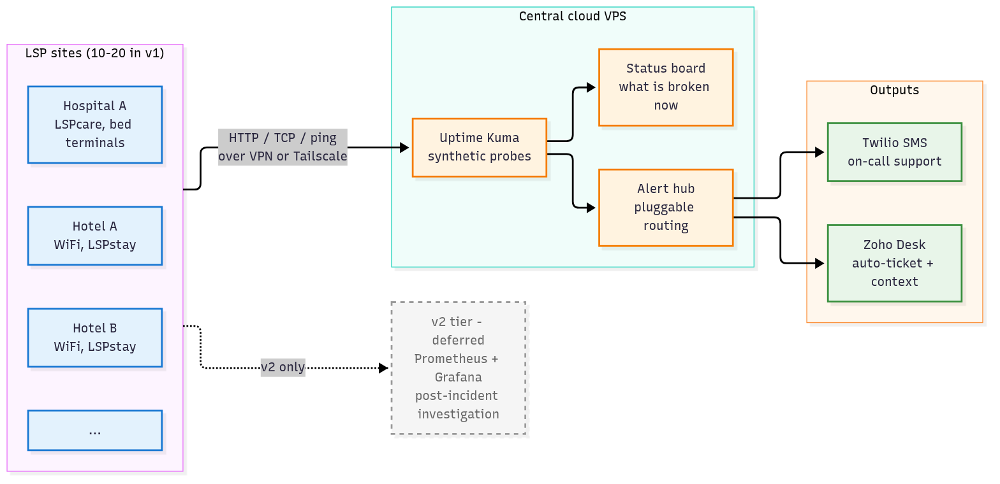
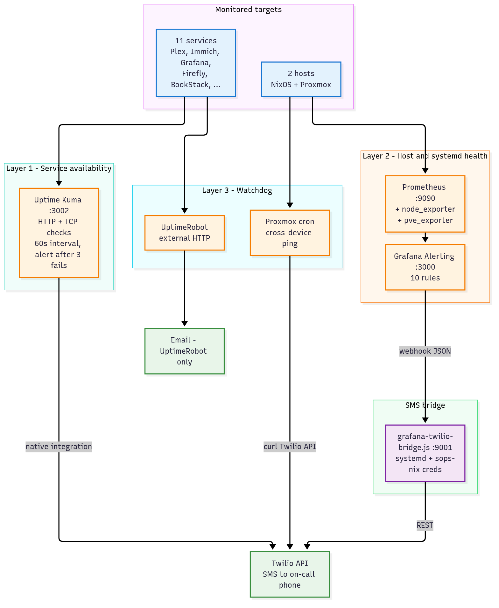

## What this document is

A single hand-over of what Ivan proposed on 17 November 2026: a side-of-desk engagement to build a telemetry and incident-detection system for Lifestylepanel, aligned to the CEO's stated vision. It's written to stand on its own — you don't need Ivan in the room to understand it.

The document has four parts:

1. The arrangement — how this would work alongside Ivan's Sales role
2. What the system does — in plain language, with a diagram
3. Proof it already works — Ivan runs the same pattern at home today
4. What LSP would need to provide, risks, and next steps

---

## 1. The arrangement

Ivan continues in his current role as Sales & Project Specialist, at current salary. The telemetry build becomes a parallel engineering engagement he owns, scoped to roughly 10 focused hours per week.

- No role change, no pay change.
- LSP gets the system built, from someone already inside the business.
- Ivan keeps the engineering output on his personal record — relevant to his longer-term technical trajectory.

This document is a starting point for a conversation, not a scope commitment. If we're aligned, Ivan comes back within a week with a written scope, milestone plan and a signed-off v1 definition.

---

## 2. What the system is for

> *"Know about customer-visible problems before the customer notices."*

That one line is the core of the design. It reframes the project from an **infrastructure monitoring platform** (which is where the January 2026 draft was heading) into an **incident detection and response system** for support staff and management.

The practical examples you described:

- Site WiFi goes down — we hear about it from our own system, not from the hotel manager calling in.
- A hospital bed terminal stops responding — Zoho ticket opens automatically with full context.
- An LSPcare instance starts throwing errors — on-call support gets a text within three minutes.

Everything about the design follows from that one framing: lead with customer-experience signals, not server metrics; lead with alerts, not dashboards; make ticketing a first-class output, not an afterthought.

### v1 — minimum viable incident detection

Four components, deliverable as a single pilot slice.

**Target: 3 sites inside 6 weeks of start, expanding to 10–20 sites by month 6.**

1. **Per-site health checks.** A central server that pings each site's critical endpoints — the LSPcare and LSPstay web applications, the WiFi gateway, bed terminals — every 60 seconds. If three in a row fail, we flag an incident.

2. **Live status board.** A single webpage the support team keeps open, answering *"what's broken right now, which customer is affected, since when, who owns it."* Not analytical charts — just the live current state of every site.

3. **SMS alerting.** On-call support staff get a text within about three minutes of an incident firing. Deduplication, grouping ("one message per site, not one per probe"), and business-hours routing are all configurable.

4. **Zoho Desk auto-ticketing.** When an incident fires, a Zoho ticket is created automatically with full context: site, service, what signal failed, when it started. Built against a thin interchangeable layer — if LSP ever changes ticketing systems, we reconfigure the integration rather than rebuild it.

**Zoho Desk — pre-checked for feasibility.** Ivan has confirmed Zoho Desk's public API supports everything we need: ticket creation, ticket search, user/agent lookup, and webhook events on ticket create/update/close. No surprises; nothing blocks us from building this.

### v2 — after v1 proves value

- **Stale-ticket escalator.** Watches Zoho Desk for tickets that have sat too long without activity, texts the responsible support staff. Thresholds configurable per severity.
- **Deeper investigation stack.** The server-side metrics layer the original January draft focused on — CPU, memory, disk, network on site hardware. Not needed to *detect* incidents (v1 handles that) but extremely useful to *investigate* them once we've been alerted.
- **Per-customer views.** If the business wants customers to see the live status of their own site, we add a scoped version of the status board per customer.

### The v1 architecture at a glance

**How to read this:** sites on the left feed probes to a central cloud server. The server runs the health checks, the live status board, and an alert router that sends events to Twilio (for SMS) and Zoho Desk (for tickets) in parallel. The dotted line at the bottom is the v2 deeper-investigation stack, deferred until v1 proves value.

\newpage

## 3. Proof this isn't theoretical

Ivan already runs the same architecture pattern at home, on his own infrastructure. This is the central reason the v1 timeline is realistic: the hardest engineering already exists and has been tested.

### What's running today

Monitoring 11 services and 2 hosts in Ivan's home environment, with 14 alert rules firing to SMS via Twilio. All credentials encrypted, infrastructure defined as code, and verified by real alerts over the last month.

**How to read this:** the same shape as the LSP v1 design — probes, alert router, SMS out. The only differences are (a) LSP v1 adds Zoho Desk as a second output next to Twilio, and (b) the middle "Grafana" layer here moves to LSP v2.

### A real incident, start to finish

**How to read this:** when a monitored service stops responding, three consecutive 60-second health checks fail, an alert fires, and an SMS lands on the on-call phone within roughly three minutes of the original failure. That's the detection budget — tunable per signal if some incidents warrant faster or slower alerting.

### Evidence from the live system

The next two pages show (a) the current status board and (b) a real SMS alert received from the homelab. These are included so the "this already works" claim has evidence sitting next to it.

\newpage

{ width=100% }

*The current homelab status board. Eleven monitored services, uptime percentages, response-time graphs. Each row here is the equivalent of one monitored endpoint at a future LSP site.*

\newpage

{ width=55% }

*An actual Twilio SMS the homelab sent when a service went down. Received on-call within three minutes of the first failed health check. Same pattern LSP v1 uses — one message per incident, with site, service, and timestamp context built in.*

\newpage

### How the homelab maps onto LSP v1

| Already running at home | LSP v1 equivalent |
|---|---|
| Health checks on 11 home services | Same tool, pointed at per-site endpoints (WiFi, LSPcare, bed terminals) |
| Deeper monitoring stack (2 hosts, 10 rules) | Deferred to v2 as the deeper investigation layer |
| SMS bridge (small Node.js service) | Same bridge, Twilio unchanged, Zoho Desk added in parallel |
| Secrets stored encrypted, never in code | Same pattern — credentials never checked into version control |
| One on-call phone | Routed by severity and site, multiple on-call rotations if needed |
| One home, one Proxmox host | 10–20 sites in the pilot, extending toward 60+ in v2 and beyond |

**Bottom line:** nothing in the LSP v1 proposal needs to be invented. It's a working pattern Ivan already operates, repointed at LSP endpoints with Zoho Desk added as a second output.

---

\newpage

## 4. Timeline, cost, what LSP needs to provide

### Capacity and timeline

| | v1 | v2 |
|---|---|---|
| Effort | 8–12 focused hrs/week | 6–10 focused hrs/week |
| Calendar | 2–3 months to first pilot site, 6–9 months to 10–20 sites | Begins once v1 is stable |
| Scope | Detection + alert + ticket | Investigation + escalation + per-customer views |

**Honest framing:** the original January draft targeted 60+ sites and 1M data points per minute. That ambition isn't dropped — it belongs after v1 is proven and probably after v2 is in flight. A side-of-desk engagement that lands 10–20 sites with reliable detection in six months is a better outcome than committing to 60 and delivering half-finished pieces of all of them.

### What LSP would need to provide

- **Network access** — a way for a central server to reach each pilot site's endpoints (existing VPN, Tailscale, or similar). If some sites can't be reached centrally, a small per-site prober can phone home instead.
- **Zoho Desk API credentials** (ticket-create and ticket-read scopes) + a prioritised list of must-have v1 signals per LSP product.
- **Cloud budget** — one VPS (roughly A$30–50/month, Hetzner or similar) + Twilio SMS volume (around A$20/month at pilot scale, grows with site count).
- **Portfolio rights** — written permission for Ivan to publicly describe the architecture and outcomes, within commercial-sensitivity limits agreed upfront. This is part of his side-of-desk value proposition and worth settling upfront.

### Risks and mitigations

| Risk | Mitigation |
|---|---|
| Alert fatigue — too many low-priority pings | Tiered severity, business-hours routing, weekly review of noisiest rules |
| A site can't be reached from the central server | Per-site phone-home prober option in the v1 architecture from day one |
| Zoho Desk API outages or changes | Interchangeable integration layer with retry queue; monitor the integration itself |
| Side-of-desk slips if Sales workload spikes | Monthly check-in; v1 scope sized assuming 2–3 weeks of lost time per quarter |
| Portfolio-rights disagreement later | Agreed scope of what Ivan can publish, signed off before anything public is written |

### What good looks like at the six-month mark

- 10–20 sites instrumented with v1.
- Measurable proportion of customer-reported issues now caught by the system before the customer calls in. Actual percentage to be measured against three months of baseline Zoho data, not estimated in advance.
- Weekly or monthly on-call load visible in SMS volume and Zoho ticket flow, so the support team can see what the system is catching for them.
- Clear next-step decision point on whether to continue to v2.

---

## 5. Next steps

If this direction is right:

1. Ivan comes back inside one week with a written scope, milestone list, and a signed-off v1 definition.
2. LSP provides the Zoho API credentials, site connectivity, and portfolio-rights sign-off.
3. First pilot site is instrumented and live inside 6 weeks of green-lighting.
4. Monthly written check-in (15 minutes to read) tracks progress, blockers and site count.

If this direction isn't right — or if LSP would rather sequence the AI technical-support receptionist project first — Ivan is happy to defer this and revisit later. Both projects fit side-of-desk; both are compatible with his continuing Sales role.

---

*Prepared by Ivan Van Rooyen · November 2026 · ivanvanrooyen1666@gmail.com*
