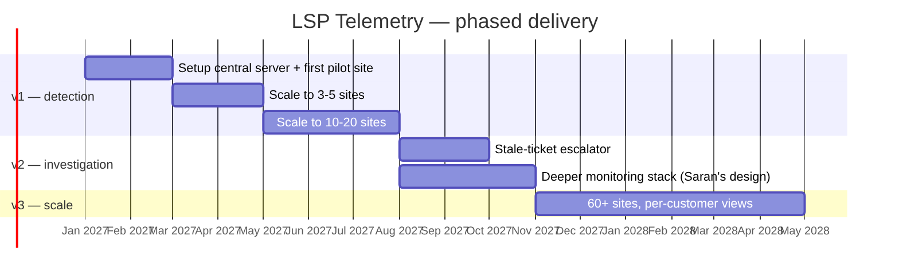
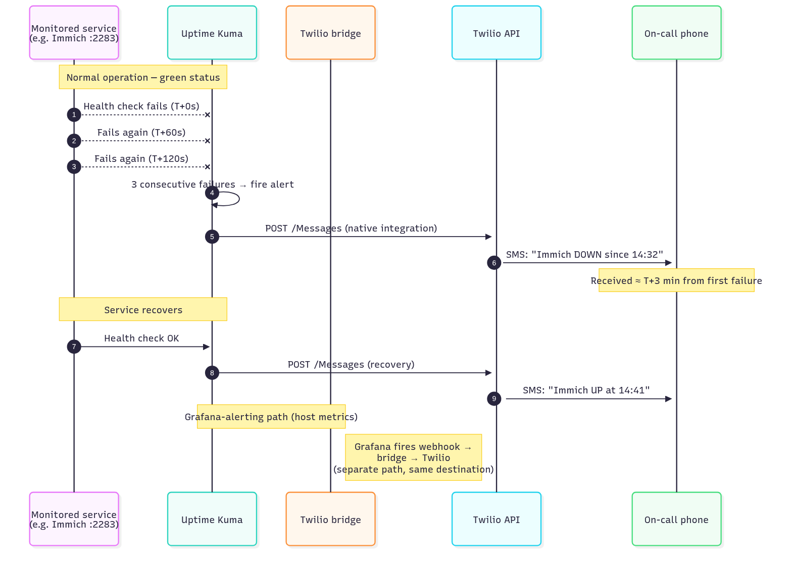
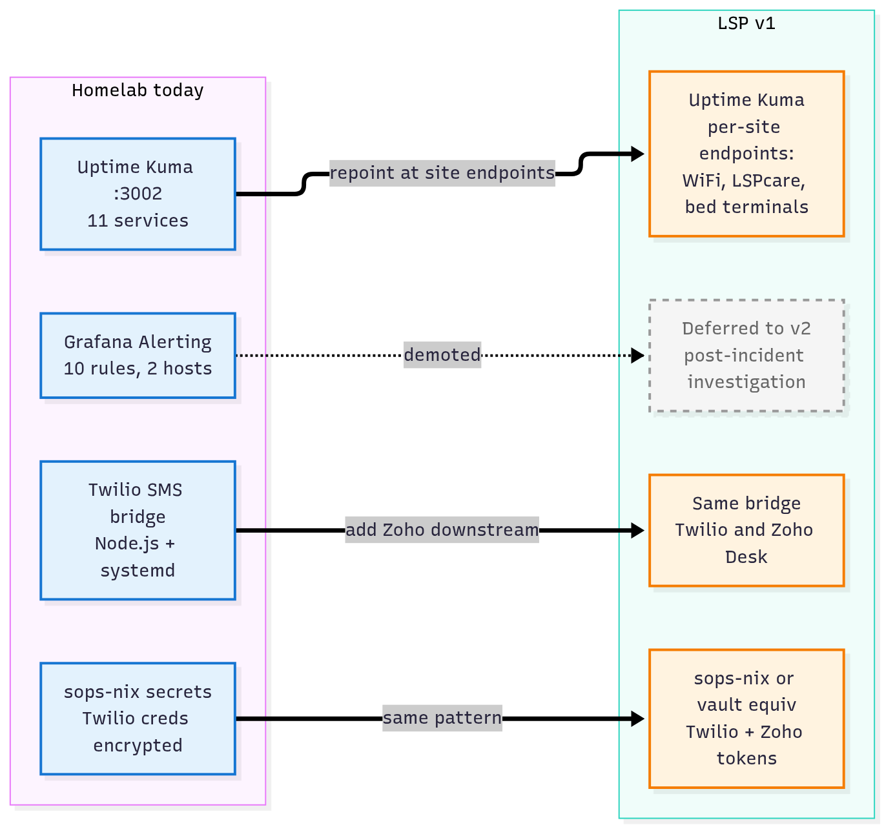

## The proposal

> **Keep my Sales role at current salary. Build the telemetry system side-of-desk, ~10 hrs/week. Ship v1 across 10–20 sites in 6–9 months.**

Four things this gets you:

- A working incident-detection system for every pilot site, aligned to **your** vision — not a rewrite of Saran's January draft.
- Delivery by someone already inside the business, already familiar with LSP's products and customers.
- No role change, no pay change, no org chart disruption.
- An engineering build whose scope and cadence I can defend to you monthly, because it's mine.

### Your framing, carried through the whole design

> *"Know about customer-visible problems before the customer notices."*

That one sentence sets the shape of v1:

- **Lead with customer-experience probes** — did the WiFi work? did LSPcare respond? did the bed terminal ping? Not server metrics (CPU, memory, disk) — those move to v2.
- **Primary output: SMS to on-call + auto-created Zoho ticket.** Not Grafana-style analytical dashboards — those move to v2 too.

```{=typst}
#pagebreak()
```

## What v1 looks like


**Four components, one pilot slice:**

1. **Per-site health checks** every 60 seconds against each site's critical endpoints. Three consecutive failures = incident.
2. **Live status board** — one page the support team keeps open, showing what's broken right now and since when.
3. **SMS to on-call** within ~3 minutes of an incident firing.
4. **Zoho Desk auto-ticketing** with full context (site, service, signal, timestamps), via an interchangeable integration layer.

*Zoho Desk API pre-checked: ticket create, ticket search, user lookup, webhook events — all available. No blockers.*

```{=typst}
#pagebreak()
```

## Phased delivery

{width=100%}

- **v1 (Jan–Jun 2027)** — detection: health checks, status board, SMS, Zoho ticketing. 10–20 sites.
- **v2 (Aug 2027–)** — investigation: stale-ticket escalator + the deeper monitoring stack Saran originally designed, now sequenced correctly as the second tier.
- **v3 (Dec 2027+)** — scale: 60+ sites, per-customer views. Only committed to once v1 and v2 are proven.

```{=typst}
#pagebreak()
```

## The business case, concretely

A real 2am incident at one hospital site, with and without v1 running:

```{=typst}
#figure(
  image("diagrams/before-after-incident.png", width: 100%),
  caption: [Before and after — one incident, two timelines],
)
```

**Difference:** 10 hours of customer-visible impact drops to 90 minutes. Customer frustration drops to zero. Support team starts the day with context, not a cold call.

Multiply this across 10–20 sites and six months of operation, and the system pays for itself in support hours recovered.

```{=typst}
#pagebreak()
```

## Proof it already works

I run this exact pattern in my home environment today. 11 services + 2 hosts monitored, 14 alert rules, SMS via Twilio, infrastructure defined as code, credentials encrypted end-to-end.


**Same shape as LSP v1.** The only differences: LSP v1 adds Zoho Desk alongside Twilio, and the middle Grafana layer moves from "running today" to "v2".

```{=typst}
#pagebreak()
```

## One real incident — end to end



When a monitored service stops responding, three consecutive health checks fail, the alert router fires, and an SMS lands on the on-call phone in roughly three minutes. This flow has been live and tested on my homelab for a month.

```{=typst}
#pagebreak()
```

## Mapping the homelab onto LSP



**Nothing here needs to be invented.** The v1 build is the pattern above, repointed at LSP site endpoints, with Zoho Desk added as a second output next to Twilio.

```{=typst}
#pagebreak()
```

## What LSP would need to provide

| | |
|---|---|
| **Network access** | Reach from a central server to each pilot site (existing VPN, Tailscale, or similar). If some sites can't be reached centrally, a small per-site prober phones home instead. |
| **Zoho Desk API credentials** | Ticket-create + ticket-read scopes. |
| **Priority signal list** | Which endpoints matter most per LSP product. |
| **Cloud budget** | ~A$30–50/month VPS + ~A$20/month Twilio SMS at pilot scale. |
| **Portfolio rights** | Written permission to describe the architecture and outcomes publicly, within commercial-sensitivity limits we agree upfront. |

### Reporting cadence

- **Monthly written check-in** (15 min read) — what shipped, what's shipping next, blockers.
- **Live status board** available to you and the support team from week one.

### If this is right, next steps

1. Within one week: written scope, milestone list, signed-off v1 definition.
2. LSP provides Zoho API credentials, site connectivity, portfolio-rights sign-off.
3. First pilot site live inside 6 weeks of green light.

---

*Ivan Van Rooyen · ivanvanrooyen1666@gmail.com*
