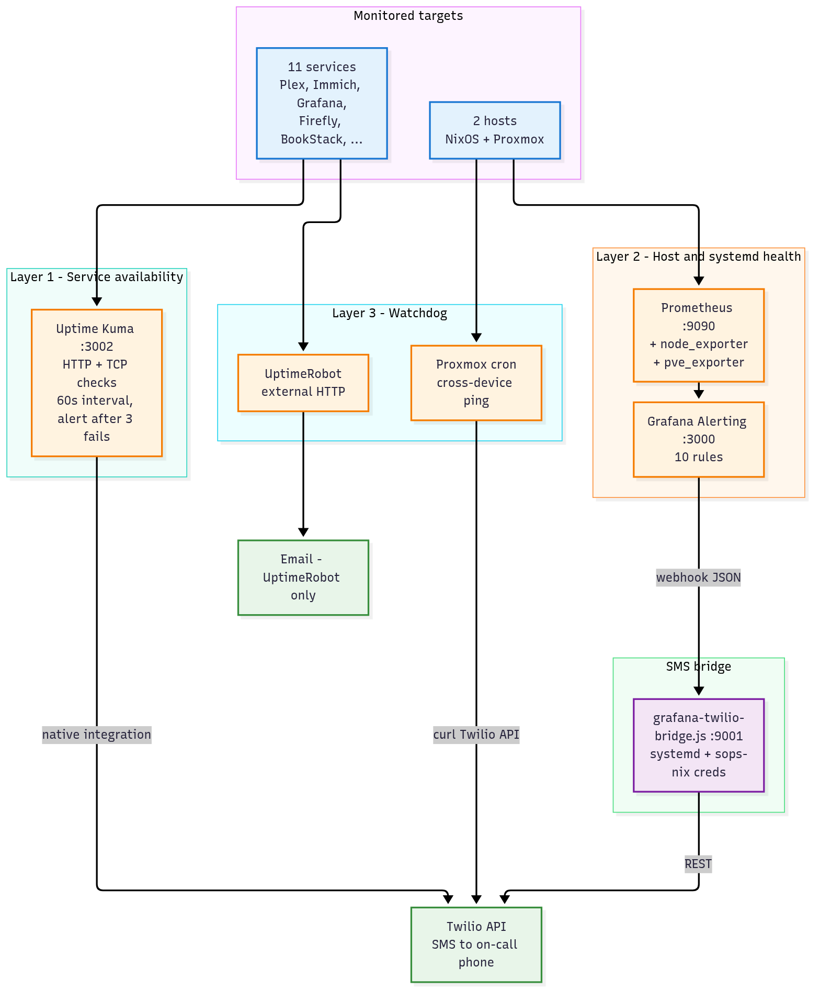
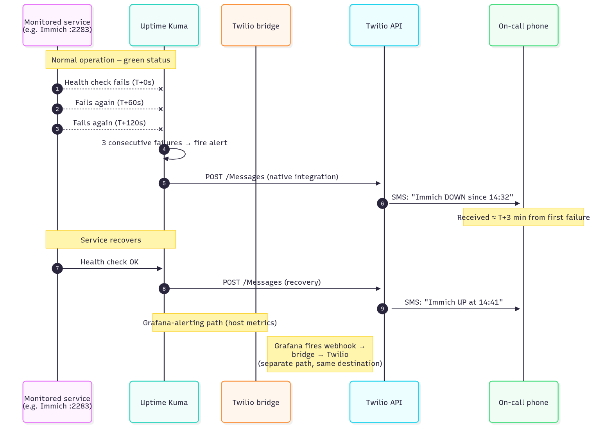
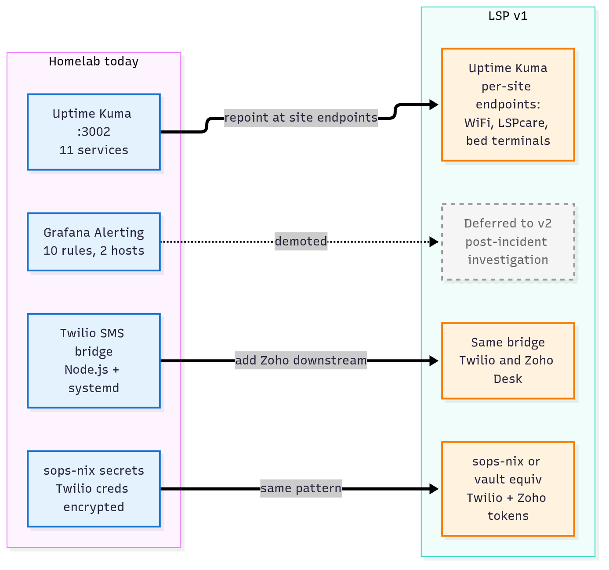

Material to bring into the CEO meeting to prove the v1 LSP telemetry architecture is already running as a working system at home. Two tracks: **live demo** (if connectivity and time allow) and **printed backup pack** (always have, hand over at the end regardless).

---

# Part 1 — Live demo

## Pre-meeting checklist (do the evening before)

- [ ] Open the three target URLs on the laptop, leave tabs loaded in order:
  - Tab 1: Uptime Kuma dashboard (`:3002`)
  - Tab 2: Grafana alerting list (`:3000/alerting/list`)
  - Tab 3: Terminal with `grafana-twilio-bridge.js` open in `less` or `bat`
- [ ] Confirm all 11 Uptime Kuma monitors green. If any are red, either fix them before Monday or use the red one as the demo incident.
- [ ] Verify Tailscale reachability from laptop: `tailscale status` shows `nixos` as online. If it doesn't, you have no demo — fix before Monday.
- [ ] Phone hotspot tested, laptop tethered, services reachable through it. Berrinba office WiFi is unknown; don't rely on it.
- [ ] Phone with SIM in it. The Twilio alerts land on the on-call number — put the phone screen-up on the table at the start.
- [ ] USB drive with PDF export of this entire pack (proposal + POC kit + diagrams) as a laptop-failure fallback.
- [ ] Printed pack (Part 2 below) in a folder, ready to hand over at the end of the meeting whether the live demo happened or not.

## Demo script — 5 minutes, or shorter

Open the demo with the frame, not the tech. The tech is the proof — the frame is what the CEO remembers.

> *"This is the same stack I'm proposing for LSP v1, running in my home environment for about a month. Let me trace one alert end-to-end."*

### Tab 1 — Uptime Kuma (90 seconds)

- Point at the 11 monitors list, all green.
- *"These are the HTTP and TCP checks running every 60 seconds. Three consecutive failures fires an alert — around three minutes end-to-end."*
- Click one monitor (pick Immich or Plex — recognisable). Show the uptime graph.
- *"In LSP v1, each row here becomes an endpoint we care about at each site: a WiFi gateway, an LSPcare login page, a bed terminal."*

### Tab 2 — Grafana Alerting (90 seconds)

- Show the alert rules page. 10 rules across Host Health, Systemd Units, Proxmox Health.
- Click into one with a clear story — "NAS Mount Gone" works well.
- *"This is the second layer. Prometheus scrapes metrics, Grafana evaluates rules, fires when conditions sustain. For LSP v1 this layer is deferred to v2 — too much setup per site for a detection-first design. But it's ready when we need post-incident investigation."*

### Optional — trigger a live alert (90 seconds, only if the meeting is going well)

- Open a terminal, stop a non-critical service:
  ```
  systemctl --user stop sunshine.service
  ```
  or similar — pick something whose outage is visible in Uptime Kuma within 60 seconds.
- Keep talking while the alert cooks. Reference your phone face-up on the table.
- When the SMS lands, pick up the phone, read the alert aloud.
- *"That's the detection half of v1. The other half — the Zoho ticket — is the component I'd build on top."*
- Restart the service: `systemctl --user start sunshine.service`. Confirm the recovery SMS when it arrives.

Skip this step if you're running short on time or if the first two tabs have landed. The printed pack carries the point for you.

### Tab 3 — The bridge code (60 seconds)

- Open `~/nixos-config/scripts/grafana-twilio-bridge.js` in the terminal.
- *"Forty lines of Node.js. Receives Grafana's webhook JSON, posts to the Twilio API. Wrapped in a systemd service, credentials loaded from sops-nix — never in git."*
- Scroll to the `LoadCredential` line if visible.
- *"For LSP v1, this same pattern plumbs the Zoho Desk integration alongside Twilio. One module, two downstreams."*

### Close (30 seconds)

> *"Nothing in the v1 proposal needs to be invented. It's this stack, repointed at LSP endpoints, with Zoho Desk added as a second downstream next to Twilio. What I'm proposing to you is to productionise a pattern I already run and operate."*

## Known risks and fallbacks

| Risk | Fallback |
|---|---|
| Berrinba WiFi won't route to Tailscale | Phone hotspot |
| Phone hotspot not working | Skip to printed pack, do not improvise |
| Laptop battery dies / hard failure | Printed pack covers everything the demo shows |
| A service is genuinely down at demo time | **Use it.** Point at the fired alert, say "this is what you'd see at a customer site." |
| Live-trigger alert takes >3 min | Keep talking through tabs 2 and 3; the SMS lands when it lands |
| Meeting runs short | Drop live demo entirely. Proposal + printed pack is sufficient |

---

\newpage

# Part 2 — Printed backup pack (leave-behind, 4 pages)

Print double-sided on good paper, staple top-left, hand to the CEO at the end of the meeting. He keeps this.

## Page 1 — Homelab architecture today



**Caption:** *The current homelab stack. Three detection layers, one SMS bridge, one Twilio downstream. For LSP v1 the Prometheus/Grafana layer is deferred to v2 and a Zoho Desk integration sits in parallel to Twilio on the output side.*

\newpage

## Page 2 — Alert flow, end to end



**Caption:** *Full round-trip of a detected incident, from first failed health check to on-call SMS. Three minutes from failure to phone is the current configured budget; it's a dial we can tune per signal severity.*

\newpage

## Page 3 — Alert inventory

The 14 alert rules running today.

### Layer 1 — Service availability (Uptime Kuma, :3002)

| Target | Check type | Alert condition |
|---|---|---|
| Plex | HTTP | 3 consecutive 60s failures |
| Audiobookshelf | HTTP | 3 consecutive 60s failures |
| Immich | HTTP | 3 consecutive 60s failures |
| Overseerr | HTTP | 3 consecutive 60s failures |
| qBittorrent | HTTP | 3 consecutive 60s failures |
| Grafana | HTTP | 3 consecutive 60s failures |
| Prometheus | HTTP | 3 consecutive 60s failures |
| Firefly III | HTTP | 3 consecutive 60s failures |
| BookStack | HTTP | 3 consecutive 60s failures |
| PostgreSQL | TCP | 3 consecutive 60s failures |
| MariaDB | TCP | 3 consecutive 60s failures |

### Layer 2 — Host and systemd health (Grafana Alerting)

**NixOS server (6 rules)**

| Alert | Condition | Sustained |
|---|---|---|
| Disk Full | filesystem > 90% | 5 min |
| NAS Mount Gone | /mnt/nas absent | 3 min |
| CPU Temp High | Tctl > 85°C | 5 min |
| NVMe Temp High | > 70°C | 5 min |
| Cloudflared Down | systemd unit not active | 2 min |
| Tailscaled Down | systemd unit not active | 2 min |

**Proxmox host (4 rules)**

| Alert | Condition | Sustained |
|---|---|---|
| Proxmox Temp High | k10temp > 70°C | 5 min |
| Proxmox Disk Full | filesystem > 90% | 5 min |
| TrueNAS VM Down | pve_up{qemu/101} < 1 | 3 min |
| Proxmox Memory High | memory > 90% | 5 min |

### Layer 3 — Watchdog

- **Proxmox cron script** — cross-device ping check every 3 min, alerts after 3 consecutive failures (~9 min).
- **UptimeRobot** — external HTTP watchdog on public hostname, 5 min interval, email alerts.

\newpage

## Page 4 — Mapping homelab to LSP v1



**What transfers and what doesn't:**

| Homelab today | LSP v1 |
|---|---|
| Uptime Kuma, 11 services | Uptime Kuma, per-site endpoints (WiFi, LSPcare, bed terminals) |
| Grafana Alerting, 10 rules, 2 hosts | Deferred to v2 (post-incident investigation layer) |
| Twilio SMS bridge, Node.js, systemd | Same bridge, Twilio unchanged, Zoho Desk added in parallel |
| sops-nix secrets | sops-nix or vault equivalent — same pattern, never in git |
| One Twilio number, one on-call phone | Routed by severity and site, multiple on-call rotations if needed |
| One home, one Proxmox host | 10–20 sites in pilot, extending toward 60+ in v2 and beyond |

**Bottom line:** everything in LSP v1 is this stack, repointed and re-wrapped. The novel engineering is the Zoho Desk integration layer and the per-site onboarding flow — not the monitoring core.

---

\newpage

# Part 3 — Likely CEO questions, with Ivan's pre-prepared answers

Not scripted word-for-word — just the shape of the answer you want to give, so you don't have to improvise under pressure.

### *"Why not just extend what Saran started?"*

Saran's design is excellent for an ops-engineer infrastructure platform. Your vision is for support staff to catch customer-visible problems before the customer. That's a different problem — the detection surface is user-experience endpoints, not infra metrics. So I'd keep Saran's design as the v2 investigation layer, but lead with endpoint probes for v1. It's not binned, just resequenced.

### *"How do I know you'll finish it?"*

You don't, in the sense that no one can promise that. What you can look at: I've shipped the exact same pattern at home end-to-end — monitoring, alerting, SMS, infrastructure-as-code, secrets management, verified restore drills. I'd propose a monthly check-in so slippage is visible early, and v1 scope sized assuming 2–3 weeks of lost time per quarter from the Sales day job.

### *"What if the Sales workload spikes?"*

v1 scope is sized assuming it happens. I'd rather commit to 10 sites in six months and deliver cleanly than commit to 30 and leave half of them half-wired. If quarterly Sales volume means I lose a month, the milestone list shifts by a month — I'd flag it at the check-in rather than silently slipping.

### *"Zoho Desk — are we locked in forever?"*

No. The integration layer is pluggable by design. If you decide in 2027 that Freshdesk or Jira Service Management is a better fit, we reconfigure the integration, we don't rebuild the system. v1 ships with Zoho because that's what you use today.

### *"What's the risk this becomes a side project that quietly dies?"*

Three things reduce that risk: (1) the arrangement is written down with a milestone list, (2) monthly check-ins catch slippage early, (3) v1 is sized small enough that even a slow quarter still ships a working pilot site. If after six months we've landed three sites and it's clearly not working, we end it cleanly — that's a better outcome than drifting.

### *"Can we talk about portfolio rights later?"*

I'd rather settle the shape now, even if we don't sign anything today. It's part of what makes this arrangement work for me — I keep the engineering output on my record. "I can describe the architecture publicly but not customer names, deal sizes, or confidential config" is a reasonable starting line.

### *"What about Jason?"*

Jason's networking background is complementary — he owns the network layer at sites, I own the monitoring layer on top of it. I'd want him in the loop operationally from week one, especially on the connectivity side (VPN, Tailscale, site routing). This isn't me stepping around him.

### *"Can we start with just the AI receptionist and come back to telemetry?"*

The two are compatible — the receptionist is a weeks-not-months engagement, and the telemetry build is paced in hours per week. I'd be fine sequencing them with the receptionist first if that fits better. Let's agree a rough order and I'll come back with scope on both.

### *"How do I keep track of this if I'm not in the detail?"*

Monthly written check-in: current state, what shipped in the last month, what's shipping next month, blockers. Fifteen minutes to read, in your inbox on the 1st. Plus I'd propose the status board itself is accessible to you and the support team from day one — you see live state whenever you want.

---

\newpage

# Part 4 — Post-meeting follow-up template

Send within 48 hours of the meeting while the alignment is fresh. Short, plain email.

```
Subject: LSP telemetry — follow-up from Monday

Hi [CEO name],

Thanks for the time on Monday. Capturing what I heard so we're
aligned before I come back with a scoped plan:

- Arrangement: I continue in Sales & Project Specialist, telemetry
  becomes a parallel engagement at current salary, ~10 hrs/week.
- Priority: customer-visible problem detection first. Infra metrics
  come in v2.
- v1 scope: endpoint probes, status board, Twilio SMS, Zoho Desk
  ticket integration.
- Portfolio rights: [what you agreed, or "to be defined before I
  start"].
- Next step from me: written scope + milestone plan by [date,
  within one week].

If any of the above looks wrong, let me know this week so we start
from the right place. Happy to walk through any of it on a call
before I write the scope doc.

Ivan
```

**If the CEO said yes in principle but hasn't committed:** add a line at the top asking for confirmation on whether to proceed to scope-doc stage.

**If the CEO said he wants to think about it:** send the same email minus the "next step" line, with a soft re-raise date two weeks later in your own calendar.

**If the CEO said no:** still send a short thank-you. The relationship outlives the outcome.
