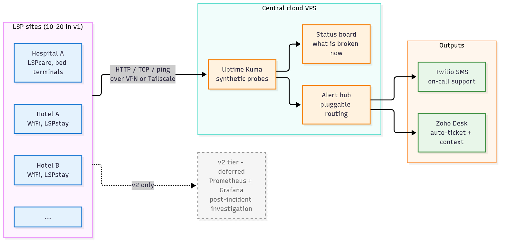

## The arrangement

Continue as Sales & Project Specialist at current salary. Telemetry becomes a parallel engineering engagement I own, scoped to ~10 focused hours a week. No role transition, no pay change — LSP gets the system; I keep the engineering output on my record.

This proposal is a starting point for a conversation, not a scope commitment. If we're aligned in the room, I come back inside a week with a written scope, milestone plan and a signed-off v1 definition.

## What the system is for

> *"Know about customer-visible problems before the customer notices."*

That reframes the project from an **infrastructure telemetry platform** (which is where Saran's January design was heading) into an **incident detection and response system** for support staff and management. WiFi down at a site, a bed terminal unreachable, an LSPcare instance throwing errors — we hear about it from our own system, not from the customer's call.

Everything downstream of that framing gets simpler: lead with synthetic probes, not infra metrics; lead with alerts, not dashboards; make Zoho Desk a first-class output, not an afterthought.

## v1 — minimum viable incident detection

Four components, deliverable as a single pilot slice. Target: 3 sites inside 6 weeks of start, expanding to 10–20 by month 6.

1. **Per-site endpoint probes.** Uptime Kuma (or equivalent) running on the central VPS, synthetic checks against each site's endpoints — HTTP health for LSPcare / LSPstay, TCP reachability for the WiFi gateway, ping for bed terminals. Checks run over existing VPN / Tailscale. Priority list of signals comes from you.
2. **Status board.** A single dashboard answering "what's broken right now, which customer is affected, since when, who owns it." Operational, not analytical.
3. **SMS alerting.** Twilio-backed, routed to on-call support staff via a tiny webhook bridge — the same pattern I already run in production at home (see POC pack). Dedupe, grouping and business-hours routing configurable.
4. **Zoho Desk auto-ticketing** via a pluggable integration layer. When an incident fires, a ticket is created with context (site, service, signal, timestamps). If LSP ever changes ticketing systems, the integration is reconfigured — not rebuilt.

## v2 — after v1 proves value

- **Stale-ticket escalator.** Polls Zoho Desk, SMSes the responsible support staff when a ticket passes its SLA window without activity. Thresholds configurable per severity.
- **Infrastructure metrics layer.** Prometheus + VictoriaMetrics + Grafana as a *second* tier for post-incident investigation — CPU, memory, disk, SNMP on site hardware. This is Saran's original design, preserved and demoted. Useful once v1 is detecting incidents, not required to detect them.
- **Multi-tenant / per-customer views.** Scoped per the original SDD's DNS-swap pattern if the business needs it.

## Capacity and timeline

| | v1 | v2 |
|---|---|---|
| Effort | 8–12 focused hrs/week | 6–10 focused hrs/week |
| Calendar | 2–3 months to first pilot site, 6–9 months to 10–20 sites | Begins once v1 is stable |
| Scope | Detection + alert + ticket | Investigation + escalation + per-customer views |

Honest framing: the original SDD targeted 60+ sites at 1M metrics/minute. That ambition isn't dropped — it belongs after v1 is proven and probably after v2 is in flight. A side-of-desk engagement that lands 10–20 sites with reliable detection in six months is a better outcome than committing to 60 and delivering half-finished pieces of all of them.

## What I'd need from LSP

- **Connectivity** — read-only VPN / Tailscale reachability from a central point to each pilot site. If some sites can't be reached that way, I'll install a lightweight phone-home prober per site instead.
- **Zoho Desk API credentials** (ticket-create and ticket-read scopes) + a prioritised list of must-have v1 signals per LSP product.
- **Cloud budget** — one VPS (~A$30–50/month, Hetzner or similar) + Twilio SMS volume (~A$20/month at pilot scale, scales with site count).
- **Portfolio rights** — written permission to publicly describe the architecture and outcomes, within commercial-sensitivity limits we agree on. This is part of my side-of-desk value proposition.

## Proof this isn't theoretical

I already run this exact pattern at home. Uptime Kuma + Grafana Alerting + a Twilio SMS bridge I wrote in Node.js, 11 services and 2 hosts under watch, 14 alert rules, secrets via sops-nix, end-to-end tested. Live demo today if the connectivity allows; printed walkthrough in your hand regardless.

\newpage

# Appendix — v1 architecture

The target state for v1 at the first pilot site, then at every site:

## Component breakdown

| Component | Purpose | Candidate tech |
|---|---|---|
| Synthetic probes | HTTP / TCP / ping checks from central VPS to each site | Uptime Kuma, Gatus, Blackbox Exporter |
| Status board | "What's broken right now" view for support + management | Uptime Kuma status page, custom Next.js board |
| Alert hub | Deduplicates and routes incidents to Twilio and Zoho Desk | Alertmanager-style router, or a thin custom service |
| SMS output | Operator notification | Twilio SMS API via bridge service |
| Ticket output | Persistent incident record | Zoho Desk REST API behind pluggable interface |
| v2 metrics tier | Post-incident investigation only | Prometheus + VictoriaMetrics + Grafana |

## Design properties carried over from Saran's original design

- **Modular client-server split** — per-site probers (where needed) update independently of the central stack.
- **Resilience** — local buffering if a site goes offline; alerts fire on reconnection with correct timestamps.
- **Multi-tenant ready** — v1 is single-tenant; v2 adds per-customer DNS-swap isolation if the business needs it.

## What changes from Saran's design

- **METPA custom Go agent and Kafka deferred.** Prometheus Agent mode with ~7-day WAL retention gives the same local-buffer story at a fraction of the complexity.
- **Lead with endpoint probes, not Prometheus exporters.** CEO's vision is user-experience signals first, infra metrics second.
- **Grafana demoted to post-incident investigation.** Not removed — just not the primary UI.
- **Zoho Desk is a first-class output,** not a downstream afterthought.

## Risks and how I'd mitigate them

| Risk | Mitigation |
|---|---|
| Alert fatigue — too many low-priority pings | Tiered severity + business-hours routing; weekly review of noisiest rules |
| Site unreachable from central prober | Per-site phone-home prober option in v1 architecture from day one |
| Zoho Desk API limits or outages | Pluggable integration layer + retry queue; monitor the integration itself |
| Side-of-desk slips if Sales workload spikes | Monthly check-in; v1 scope sized assuming 2–3 weeks of lost time per quarter |
| Portfolio-rights blocker | Agreed scope of what I can publish, signed off before I start writing anything public |
