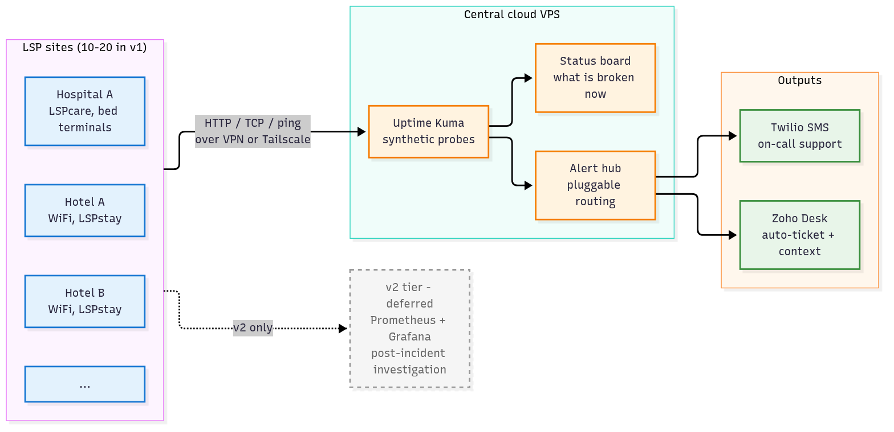

## The arrangement

Continue as Sales & Project Specialist at current salary. Telemetry becomes a parallel engineering engagement I own, scoped to ~10 focused hours a week. No role transition, no pay change — LSP gets the system; I keep the engineering output on my record.

This proposal is a starting point for a conversation, not a scope commitment. If we're aligned in the room, I come back inside a week with a written scope, milestone plan and a signed-off v1 definition.

## What the system is for

> *"Know about customer-visible problems before the customer notices."*

That reframes the project from an **infrastructure telemetry platform** (which is where Saran's January design was heading) into an **incident detection and response system** for support staff and management. WiFi down at a site, a bed terminal unreachable, an LSPcare instance throwing errors — we hear about it from our own system, not from the customer's call.

Everything downstream of that framing gets simpler: lead with synthetic probes, not infra metrics; lead with alerts, not dashboards; make Zoho Desk a first-class output, not an afterthought.

## v1 — minimum viable incident detection

Four components, deliverable as a single pilot slice. Target: 3 sites inside 6 weeks of start, expanding to 10–20 by month 6.

1. **Per-site health checks.** A central server that pings each site's critical endpoints — the LSPcare and LSPstay web applications, the site's WiFi gateway, bed terminals — every 60 seconds. If three in a row fail, we flag an incident.
2. **Live status board.** A single webpage the support team keeps open, answering *"what's broken right now, which customer is affected, since when, who owns it."* Not analytical charts — just the current state of every site.
3. **SMS alerting.** Twilio-backed. On-call support staff get a text within ~3 minutes of an incident firing. Dedupe (no SMS floods), grouping (one message per site, not one per probe), and business-hours routing are all configurable. Same pattern I already run in production at home.
4. **Zoho Desk auto-ticketing.** When an incident fires, a Zoho ticket is created automatically with context: site, service, what signal failed, when. Built against a thin interchangeable layer — if LSP ever changes ticketing systems, we reconfigure the integration rather than rebuild it.

### Zoho Desk — pre-checked for feasibility

I've confirmed Zoho Desk's public API supports everything we need: create ticket, search/list tickets, look up agents and users, plus webhook events on ticket create/update/close. Authentication is OAuth2. No surprises; nothing blocks us from building this.

## v2 — after v1 proves value

- **Stale-ticket escalator.** Watches Zoho Desk for tickets that have sat too long without activity, texts the responsible support staff. Thresholds configurable per severity ("critical" might be 2 hours, "low" might be 48).
- **Infrastructure metrics layer.** The deeper monitoring stack Saran originally designed — CPU, memory, disk, network, SNMP on site hardware. Not needed to *detect* incidents (v1 handles that) but extremely useful to *investigate* them once we've been alerted.
- **Per-customer views.** If the business wants customers to see the live status of their own site, we add a per-customer scoped version of the status board.

## Capacity and timeline

| | v1 | v2 |
|---|---|---|
| Effort | 8–12 focused hrs/week | 6–10 focused hrs/week |
| Calendar | 2–3 months to first pilot site, 6–9 months to 10–20 sites | Begins once v1 is stable |
| Scope | Detection + alert + ticket | Investigation + escalation + per-customer views |

Honest framing: the original SDD targeted 60+ sites at 1M metrics/minute. That ambition isn't dropped — it belongs after v1 is proven and probably after v2 is in flight. A side-of-desk engagement that lands 10–20 sites with reliable detection in six months is a better outcome than committing to 60 and delivering half-finished pieces of all of them.

## What I'd need from LSP

- **Connectivity** — read-only VPN / Tailscale reachability from a central point to each pilot site. If some sites can't be reached that way, I'll install a lightweight phone-home prober per site instead.
- **Zoho Desk API credentials** (ticket-create and ticket-read scopes) + a prioritised list of must-have v1 signals per LSP product.
- **Cloud budget** — one VPS (~A$30–50/month, Hetzner or similar) + Twilio SMS volume (~A$20/month at pilot scale, scales with site count).
- **Portfolio rights** — written permission to publicly describe the architecture and outcomes, within commercial-sensitivity limits we agree on. This is part of my side-of-desk value proposition.

## Proof this isn't theoretical

I already run this exact pattern at home. Uptime Kuma + Grafana Alerting + a Twilio SMS bridge I wrote in Node.js, 11 services and 2 hosts under watch, 14 alert rules, secrets via sops-nix, end-to-end tested. Live demo today if the connectivity allows; printed walkthrough in your hand regardless.

\newpage

# Appendix — v1 architecture

The target state for v1 at the first pilot site, then at every site:

## Component breakdown

| Component | What it does | Candidate tools |
|---|---|---|
| Health checks | Pings each site's critical endpoints every 60 seconds | Uptime Kuma, Gatus |
| Status board | Live "what's broken right now" page for support and management | Built into Uptime Kuma, or a thin custom webpage |
| Alert router | Decides who gets notified about what, suppresses noise | Lightweight purpose-built service |
| SMS output | Texts on-call support when an incident fires | Twilio API, called via a small bridge service |
| Ticket output | Creates a Zoho Desk ticket with full context | Zoho Desk REST API behind a thin interchangeable layer |
| v2 investigation stack | Deeper metrics (CPU, memory, disk, network) for incidents already detected | Prometheus + Grafana — industry-standard stack |

## What carries over from Saran's design

- **Central-server / per-site split** — the system is built so sites and the central server can be updated independently of each other.
- **Resilience** — if a site goes offline, nothing is lost. When the site comes back, alerts fire with the correct original timestamps.
- **Multi-tenant ready** — the architecture supports per-customer isolation when we need it in v2 or later.

## What's different from Saran's design

- **The custom data-collection agent and message queue Saran designed are deferred.** A standard tool (Prometheus in "agent mode") gives us the same local-buffering capability with far less code to write and maintain.
- **Lead with customer-experience signals, not server metrics.** CEO's vision is "did the customer's thing work," not "what's the CPU at." Server metrics stay — they just move to v2.
- **Deeper monitoring stack moves to v2.** Not dropped, just sequenced after v1 proves value.
- **Ticketing is a first-class output,** not a downstream afterthought.

## Risks and how I'd mitigate them

| Risk | Mitigation |
|---|---|
| Alert fatigue — too many low-priority pings | Tiered severity + business-hours routing; weekly review of noisiest rules |
| Site unreachable from central prober | Per-site phone-home prober option in v1 architecture from day one |
| Zoho Desk API limits or outages | Pluggable integration layer + retry queue; monitor the integration itself |
| Side-of-desk slips if Sales workload spikes | Monthly check-in; v1 scope sized assuming 2–3 weeks of lost time per quarter |
| Portfolio-rights blocker | Agreed scope of what I can publish, signed off before I start writing anything public |
